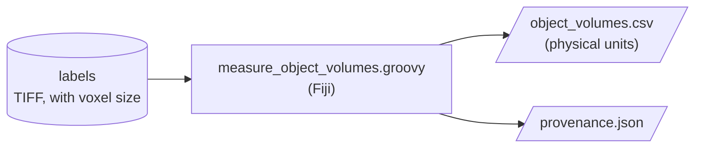

# Usage



The scripts are in the `fiji/` folder of the repository. Each one declares
its inputs at the top, so Fiji shows a dialog for them when you run it.

## In Fiji

1. Drag the `.groovy` file onto the Fiji window, or use **File > Open**. It
   opens in the script editor.
2. Click **Run**. A dialog asks for the parameters.
3. Results and a `provenance.json` record are written to the output folder
   you chose. Messages appear in the Console window.

To add a script to Fiji's menus, copy it into `Fiji.app/scripts/Plugins/` and
restart Fiji.

## Without the GUI (headless)

The same script runs without a screen, e.g. as a batch job on an HPC cluster.
Give every parameter on the command line, as `name="value"` pairs separated
by commas:

```bash
/path/to/Fiji.app/fiji --headless --run fiji/measure_object_volumes.groovy \
    'labelFile="/data/labels.tif",outputDir="/data/results",requireCalibration=true'
```

Fiji exits normally even when a script fails, so check the output for
`[ERROR]` lines and that the expected files were written. The `fiji/README.md`
file in the repository covers older Fiji launchers and a workaround for
`Macro or script not found` errors.
